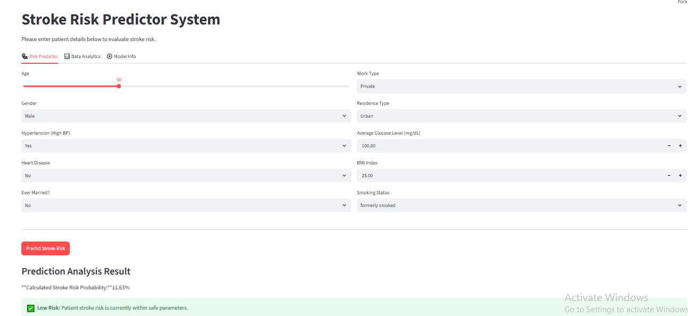

# 🩺 Stroke Risk Predictor

[](https://stroke-risk-predictor-joqchpdvjmvvyszpeztkwr.streamlit.app)
[](https://www.python.org/)
[](https://scikit-learn.org/)

An end-to-end machine learning web application that predicts a patient's stroke risk from basic health indicators to flag high-risk cases early.

🔗 **Live Application:** https://stroke-risk-predictor-joqchpdvjmvvyszpeztkwr.streamlit.app



---

## Problem

Stroke is a leading cause of death and long-term disability, but early risk flags from basic health indicators (age, glucose level, hypertension, BMI) can help prioritize patients for further screening. This app takes patient data as input and outputs a calibrated stroke risk prediction.

---

## Dataset & Approach

- Public Kaggle stroke dataset — 5,110 records, 15 preprocessed features, ~4.87% stroke prevalence (highly imbalanced)
- Handled class imbalance using `class_weight='balanced'` within Random Forest to penalize minority misclassification
- Tuned the decision threshold from the default 0.50 to 0.30 to prioritize recall, since missing a real stroke case is costlier than a false alarm
- Built an interactive Streamlit UI with three tabs: risk predictor, analytics, and model info

---

## Results

Test set: 1,022 patients (50 stroke cases), ROC AUC 0.80

| Threshold | Accuracy | Stroke precision | Stroke recall |
| :--- | :---: | :---: | :---: |
| **0.50 (default)** | 0.92 | 0.18 | 0.18 |
| **0.30 (tuned)** | 0.80 | 0.14 | 0.60 |

Lowering the threshold catches 60% of stroke cases instead of 18%, at the cost of more false alarms and lower overall accuracy. Accuracy alone is misleading on this imbalanced dataset.

---

## Tech Stack

- **Data Processing:** Python, pandas, NumPy
- **Machine Learning:** scikit-learn (Random Forest, ROC-AUC)
- **Deployment:** Streamlit, joblib

---

## Repository Structure

```text
├── Stoke_Prediction.ipynb              # Model training & threshold evaluation notebook
├── app.py                              # Streamlit web application
├── stroke_model.pkl                    # Serialized Random Forest model
├── model_columns.pkl                   # Feature column list for schema alignment
├── healthcare-dataset-stroke-data.csv  # Kaggle stroke dataset
├── requirements.txt                    # Project dependencies
├── app-preview.png                     # Application interface preview
└── README.md                           # Project documentation
````
## How to Run Locally

```bash
# 1. Clone the repository
git clone https://github.com/AbrishRizwan/stroke-risk-predictor.git

# 2. Navigate to project directory
cd stroke-risk-predictor

# 3. Install dependencies
pip install -r requirements.txt

# 4. Run the Streamlit application
streamlit run app.py
```

## Disclaimer

Educational project, not a medical diagnostic tool.

## Author

[Abrish Rizwan](https://github.com/AbrishRizwan)
